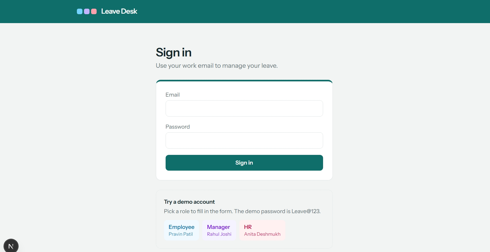
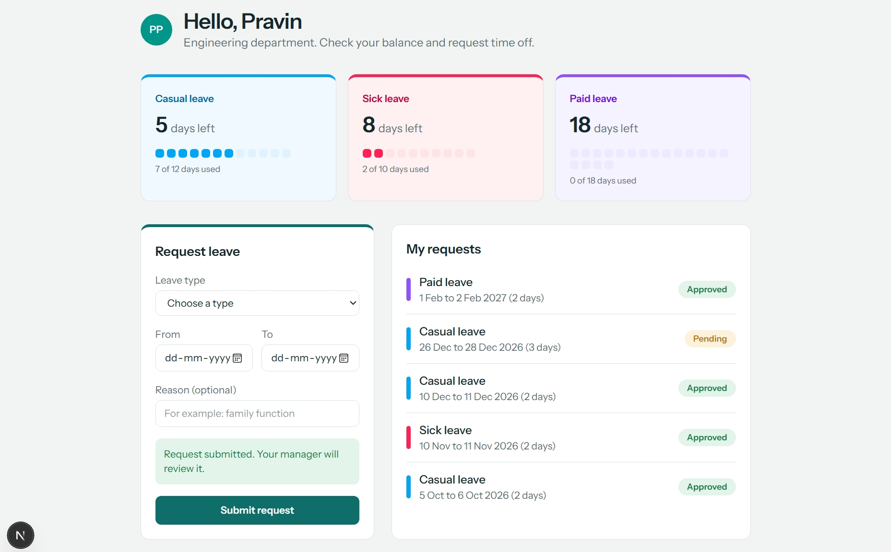
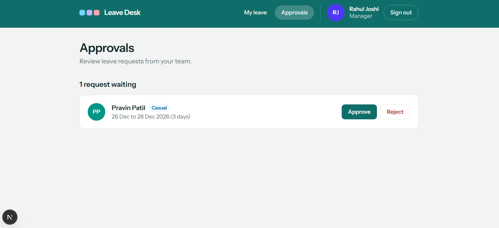

# Leave Desk (Frontend)

A leave management web app where employees request time off and managers approve or reject it. This repository is the **Next.js frontend**. It talks to a Spring Boot REST API backed by PostgreSQL.

Backend repository: [leave-management-backend](https://github.com/Kalyani7911/leave-management-backend)

## Live demo

**https://leave-management-frontend-psi.vercel.app**

Use the demo buttons on the sign-in page to log in as an employee, a manager or HR.

The backend runs on a free hosting plan that goes to sleep when nobody is using it, so the first sign-in after a quiet period can take up to a minute. After that, everything is fast.

## Screenshots

| Sign in | Employee dashboard | Manager approvals |
|---|---|---|
|  |  |  |

## Features

- Sign in with email and password. The server returns a signed JWT token that is sent with every request.
- **Employees** see their leave balance per leave type (shown as rows of day blocks), request leave, and follow the status of every request.
- **Managers** see pending requests from their own team and approve or reject them.
- The navigation changes with the role: only managers and HR see the Approvals page.
- Rules enforced by the API (overlapping dates, not enough balance, wrong team) appear as clear messages in the interface.
- Expired sessions return the user to the sign-in page.

## Tech stack

- Next.js (App Router), React, TypeScript
- Tailwind CSS
- REST API calls with `fetch`, all kept in one file (`lib/api.ts`)

## Run it locally

You need Node.js 20 or newer, and the backend running on port 8080 (see the backend repository for its setup).

1. Clone this repository and install the packages:

   ```
   git clone https://github.com/Kalyani7911/leave-management-frontend.git
   cd leave-management-frontend
   npm install
   ```

2. Create a file named `.env.local` in the project root with this line:

   ```
   NEXT_PUBLIC_API_URL=http://localhost:8080
   ```

3. Start the app and open http://localhost:3000:

   ```
   npm run dev
   ```

## Demo accounts

All demo accounts use the password `Leave@123`.

| Role | Name | Email |
|---|---|---|
| Employee | Pravin Patil | pravin.patil@example.com |
| Manager | Rahul Joshi | rahul.joshi@example.com |
| HR | Anita Deshmukh | anita.deshmukh@example.com |

The sign-in page also has buttons that fill these in for you.

## Project structure

```
app/            pages: employee dashboard, manager approvals, sign in
components/     shared interface parts (header, status badge, day blocks, avatar)
lib/api.ts      all API calls, session handling and shared types
```

## Notes

- The token is kept in the browser's local storage to keep this demo simple. A production app would normally use an httpOnly cookie instead.
- The server enforces every permission. The interface only hides what a user cannot do anyway.